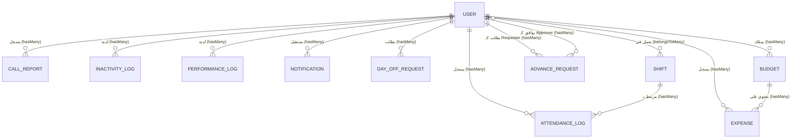

# مخطط قاعدة البيانات (Database Schema)

هذا الملف يحتوي على شرح مفصل لهيكلة قاعدة البيانات الخاصة بالنظام، بما في ذلك الجداول، الحقول المسجلة، والعلاقات بينها.

## الرسم التوضيحي للعلاقات (ER Diagram)

---

## تفاصيل الجداول والحقول

### 1. جدول المستخدمين (`Users`)
الجدول الأساسي الذي يحتوي على بيانات الموظفين والمديرين.
- `id` (UUID): المعرف الفريد للمستخدم.
- `username` (String): اسم المستخدم (يُستخدم لتسجيل الدخول).
- `password` (String): كلمة المرور (مشفرة).
- `role` (Enum): الصلاحية (`admin` أو `employee`).
- `fullName` (String): الاسم الرباعي أو الكامل.
- `jobTitle` (String): المسمى الوظيفي.
- `isActive` (Boolean): حالة الحساب (نشط أم موقوف).
- `shiftId` (UUID): معرف الوردية الأساسية للموظف.
- `customStartTime` (Time): وقت بدء مخصص (اختياري).
- `customEndTime` (Time): وقت إنهاء مخصص (اختياري).

### 2. جدول الورديات (`Shifts`)
يحتوي على مواعيد ونوعيات الورديات المتاحة في النظام.
- `id` (UUID): المعرف الفريد.
- `name` (String): اسم الوردية (مثال: الوردية الصباحية).
- `startTime` (Time): وقت البداية.
- `endTime` (Time): وقت النهاية.
- `type` (Enum): نوع الوردية (`fixed` ثابتة، أو `dynamic` مرنة).

### 3. جدول سجل الحضور والانصراف (`AttendanceLogs`)
يسجل متى حضر أو انصرف الموظف.
- `id` (UUID): المعرف الفريد.
- `userId` (UUID): معرف الموظف (FK).
- `shiftId` (UUID): معرف الوردية المرتبطة (FK).
- `date` (String): تاريخ اليوم (YYYY-MM-DD).
- `checkInTime` (Date): وقت تسجيل الحضور الفعلي.
- `checkOutTime` (Date): وقت تسجيل الانصراف الفعلي.
- `status` (Enum): حالة الحضور (`Present` حاضر، `Absent` غائب، `Late` متأخر).
- `notes` (Text): أي ملاحظات إضافية.

### 4. جدول تقارير المكالمات (`CallReports`)
يُستخدم لتسجيل المكالمات اليومية التي يجريها الموظفين.
- `id` (UUID): المعرف الفريد.
- `userId` (UUID): معرف الموظف (FK).
- `date` (String): تاريخ المكالمة.
- `clientName` (String): اسم العميل.
- `phoneNumber` (String): رقم هاتف العميل.
- `propertyType` (String): نوع العقار.
- `unitType` (String): نوع الوحدة.
- `interestedIn` (String): الاهتمامات.
- `budget` (String): ميزانية العميل.
- `contactStatus` (String): حالة التواصل.
- `contactMethod` (String): طريقة التواصل.
- `callOutcome` (String): نتيجة المكالمة.
- `propertyValue` (String): قيمة العقار.
- `dealDetails` (Text): تفاصيل الصفقة.

### 5. جدول سجلات الخمول (`InactivityLogs`)
يسجل فترات الراحة أو الخمول للموظف خلال يوم العمل.
- `id` (UUID): المعرف الفريد.
- `userId` (UUID): معرف الموظف (FK).
- `date` (String): التاريخ.
- `durationMinutes` (Integer): مدة الخمول بالدقائق.

### 6. جدول تقارير الأداء (`PerformanceLogs`)
يسجل المهام اليومية وأداء الموظف.
- `id` (UUID): المعرف الفريد.
- `userId` (UUID): معرف الموظف (FK).
- `date` (String): التاريخ.
- `dailyTasks` (Text): المهام اليومية المنجزة.
- `targetAchieved` (Boolean): هل تم تحقيق الهدف؟
- `comments` (Text): تعليقات الموظف أو المدير.
- `evaluation` (Integer): التقييم (مثلاً من 1 إلى 5).

### 7. جدول طلبات الإجازة (`DayOffRequests`)
- `id` (UUID): المعرف الفريد.
- `userId` (UUID): معرف الموظف (FK).
- `date` (String): تاريخ الإجازة المطلوبة.
- `dayName` (String): اسم اليوم.
- `reason` (Text): سبب الإجازة.
- `status` (Enum): حالة الطلب (`Pending`, `Approved`, `Rejected`).

### 8. جدول الميزانيات (`Budgets`)
يُستخدم لتعيين ميزانية شهرية لكل موظف.
- `id` (UUID): المعرف الفريد.
- `userId` (UUID): معرف الموظف (FK).
- `monthKey` (String): مفتاح الشهر (مثال: 2026-07).
- `totalBudget` (Float): الميزانية المخصصة.
- `openingBalance` (Float): الرصيد الافتتاحي.

### 9. جدول المصروفات (`Expenses`)
يُسجل المبالغ التي يتم صرفها من الميزانية الخاصة بالموظف.
- `id` (UUID): المعرف الفريد.
- `userId` (UUID): معرف الموظف (FK).
- `budgetId` (UUID): معرف الميزانية المرتبطة (FK).
- `description` (Text): تفاصيل المصروف.
- `amount` (Float): قيمة المصروف.
- `type` (Enum): نوع المصروف (`advance` سلفة، `supplies` مستلزمات).
- `date` (String): التاريخ.
- `time` (String): الوقت.
- `monthKey` (String): مفتاح الشهر.

### 10. جدول طلبات السلف (`AdvanceRequests`)
خاص بطلبات السلف المقدمة من الموظفين للمديرين.
- `id` (UUID): المعرف الفريد.
- `userId` (UUID): معرف مقدم الطلب (FK).
- `adminId` (UUID): معرف المدير الذي اتخذ القرار (FK).
- `amount` (Float): قيمة السلفة.
- `reason` (Text): السبب أو المبرر.
- `status` (Enum): الحالة (`pending`, `approved`, `rejected`, `settled`).
- `date` (DateOnly): تاريخ الطلب.
- `monthKey` (String): مفتاح الشهر (مثال: 2026-07).

### 11. جدول الإشعارات (`Notifications`)
- `id` (UUID): المعرف الفريد.
- `userId` (UUID): معرف الموظف (المستلم) (FK).
- `type` (String): نوع الإشعار (مثلاً: تنبيه خصم، رد على إجازة).
- `message` (Text): محتوى الإشعار.
- `read` (Boolean): حالة القراءة (مقروء أم لا).
- `metadata` (JSON): بيانات إضافية للربط أو التحويل (اختياري).

### 12. جدول الإعدادات (`Settings`)
جداول تخزين إعدادات النظام العامة.
- `id` (UUID): المعرف الفريد.
- `key` (String): مفتاح الإعداد (مثال: `autoCheckoutHours`).
- `value` (String): قيمة الإعداد (مثال: `1`).

---

## العلاقات (Relationships) بالتفصيل

1. **المستخدم والتقارير (One-to-Many):** 
   - كل مستخدم يمكن أن يكون لديه العديد من سجلات (المكالمات، الأداء، الخمول، الحضور). 
   - في حالة حذف المستخدم (`CASCADE`)، يتم حذف جميع التقارير المرتبطة به.

2. **المستخدم والورديات (Many-to-Many):**
   - يمكن للمستخدم أن يرتبط بأكثر من وردية عبر جدول وسيط `UserShifts` (رغم أن لكل مستخدم وردية افتراضية مسجلة في حقل `shiftId`).

3. **الوردية وسجل الحضور (One-to-Many):**
   - ترتبط الوردية بالعديد من سجلات الحضور والانصراف الخاصة بها لضبط وقت الدخول والخروج.

4. **الميزانية والمصروفات (One-to-Many):**
   - كل مستخدم لديه ميزانية لكل شهر (`Budget`). 
   - كل ميزانية يندرج تحتها العديد من المصروفات (`Expenses`).

5. **طلبات السلف (One-to-Many متعددة):**
   - المستخدم يمتلك علاقتين بجدول السلف: الأولى كمقدم للطلب (`MyAdvances` -> `Requester`)، والثانية كمدير يوافق أو يرفض الطلب (`ApprovedAdvances` -> `Approver`).
